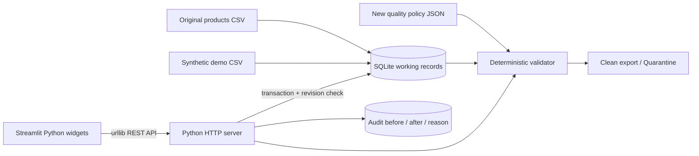

# BaanDee Product Data Quality Checker

ต้นแบบระบบตรวจคุณภาพข้อมูลสินค้า สำหรับเจ้าหน้าที่ดูแลข้อมูล BaanDee Living ตรวจปัญหา ดูหลักฐาน แก้ไขพร้อมเหตุผล และส่งออกเฉพาะรายการที่ผ่านกฎ ช่วยลดการตรวจด้วยมือเป็นสมมติฐานที่ยังต้องทดสอบกับผู้ใช้จริง ไม่อ้างว่าลดเวลาหรือความผิดพลาดได้แล้ว

## เว็บบน Streamlit Community Cloud

https://baandee-quality-studio.streamlit.app/ — ตรวจหน้าเข้าสู่ระบบแล้วเมื่อ 26 ตุลาคม 2026 บน Cloud เป็นข้อมูลตั้งต้นและบัญชีชุดใหม่ ไม่ได้อัปโหลด SQLite บนเครื่อง ดูข้อจำกัดการเก็บข้อมูลใน DEPLOYMENT.md

## เปิดระบบเวอร์ชัน Streamlit (หน้าจอหลักใหม่)

สำหรับ ZIP บน Windows: แตกไฟล์ทั้งหมดแล้วดับเบิลคลิก **start_streamlit.bat** ตัวเปิดจะตรวจ Python ที่ใช้งานได้และติดตั้ง dependencies ใน `.venv` หากยังไม่มี ครั้งแรกต้องต่ออินเทอร์เน็ต หากไม่มี Python จะบอกวิธีติดตั้ง Python 3.12 และมี `open_online.url` สำหรับเปิดเว็บโดยไม่ต้องติดตั้ง ดู [GETTING_STARTED.md](GETTING_STARTED.md) สำหรับขั้นตอนและการแก้ข้อความ Python was not found

ใช้ Python 3.10 ขึ้นไป เปิด terminal ในโฟลเดอร์นี้แล้วรัน:

```powershell
python -m pip install -r requirements.txt
python -m streamlit run streamlit_app.py
```

เปิด `http://localhost:8501` ในเบราว์เซอร์ ไม่ต้องมีบัญชีบนเว็บไซต์ Streamlit เพื่อรันบนเครื่อง ตัวเปิด Windows ใช้ `launch.py` และตรวจ Python จริง ไม่พึ่งโฟลเดอร์ work ของเครื่องที่สร้างงาน ตรวจความพร้อมโดยไม่ติดตั้งหรือเปิดเบราว์เซอร์ได้ด้วย `start_streamlit.bat --check`

Streamlit เริ่ม REST API บน loopback port ว่างให้อัตโนมัติเพียงหนึ่งตัวต่อ process หน้าจอเรียก API ผ่าน `streamlit_client.py` โดยใช้ cookie jar แยกต่อ browser session ไม่แชร์ session ของผู้ใช้ใน cache ส่วน SQLite อยู่ `data/products.sqlite3` ใช้บัญชี สินค้า และการตั้งค่าเดิมได้เมื่อรันบนเครื่องเดิม

มีเมนูคุณภาพข้อมูลสินค้า เพิ่มสินค้า ประวัติ กฎ โปรไฟล์ และตั้งค่า การเพิ่ม/แก้ไข/ตรวจ/ส่งออกผ่าน API จริง ไม่ใช่เพียงเรียกฟังก์ชันตรวจในหน้าจอโดยตรง

เมื่อรีเฟรชเบราว์เซอร์ session ของ Streamlit อาจเริ่มใหม่และต้องล็อกอินอีกครั้ง แต่บัญชี สินค้า ประวัติ และการตั้งค่าใน SQLite ยังคงอยู่หลังปิดและเปิดแอปบนเครื่องเดิม

ตัวเลือก environment variables (ตั้งใน shell ไม่อ่าน .env อัตโนมัติ):
- `BAANDEE_API_URL`: URL backend ที่มีอยู่ ถ้าไม่กำหนดจะเปิด API ภายในเอง
- `BAANDEE_DB_PATH`: ตำแหน่ง SQLite สำหรับ API ภายใน ถ้าไม่กำหนดใช้ไฟล์ทำงานเดิม

ดู [SHARING.md](SHARING.md) สำหรับแชร์เดโมผ่านอินเทอร์เน็ต และ [STREAMLIT_MIGRATION.md](STREAMLIT_MIGRATION.md) สำหรับรายละเอียดการย้าย/การเตรียม Community Cloud

### เว็บ HTML เดิม (เก็บไว้เป็นทางเลือก)

ยังเปิดเว็บเวอร์ชันเดิมด้วย `python app.py` หรือ `start.bat` ที่ `http://127.0.0.1:8765` ได้ REST API นี้ยังใช้ Python standard library ไม่ต้องติดตั้ง Streamlit หากรันเฉพาะเว็บเก่า

## ข้อมูลและกฎ

### สร้างผลข้อมูลซ้ำได้

```powershell
python scripts/prepare_data.py
```

สคริปต์ตรวจ SHA-256 ของไฟล์ดิบ นำเข้าสินค้าและชุดสาธิตในฐานข้อมูลชั่วคราว เชื่อมหมวดหมู่กับกฎจาก JSON ตรวจปัญหาก่อนแก้ ปรับเฉพาะ alias/ช่องว่างที่มีกฎยืนยัน ตรวจซ้ำ และส่งออกผลกับ audit โดยไม่เปลี่ยนฐานข้อมูลที่หน้าเว็บใช้อยู่

ไฟล์ `data/cleaned/pipeline_evidence.json` แสดงจำนวนปัญหาก่อน–หลังและหลักฐานรายแถว รวมแหล่งข้อมูล ค่าเดิม ค่าใหม่ วิธีตรวจ กฎแนะนำ และรายการที่ยังต้องให้มนุษย์ตรวจ ผลเริ่มต้นที่ทำซ้ำได้: 88 รายการ ผ่าน 73 → 78 รายการหลังปรับรูปแบบ 5 รายการ และยังแยกตรวจ 10 รายการ กรณีชื่อว่าง ราคาผิด รหัสซ้ำ และหมวดหมู่กำกวมจะคงปัญหาไว้จนมีคนยืนยัน ไม่แต่งค่าเพื่อทำให้ผลผ่าน

`.gitattributes` ปิดการแปลง line endings ของ `data/raw/` เพื่อให้ checkout บน Windows ยังคง bytes และ SHA-256 ของต้นฉบับไว้

ผลจากสคริปต์เป็น snapshot จากไฟล์เริ่มต้น ส่วนปุ่มส่งออกในหน้าเว็บเป็น snapshot ของฐานข้อมูลที่ใช้งานจริง จึงอาจมีจำนวนต่างกันหลังเพิ่มหรือแก้ข้อมูล

| แหล่ง | บทบาท / key | ที่มา |
|---|---|---|
| data/raw/products.csv | สินค้า 82 รายการ; product_id เป็น business key | จาก ZIP ที่อาจารย์ให้ เก็บ bytes ต้นฉบับ |
| data/generated/quality_policy.json | หมวดหมู่มาตรฐานและ alias เชื่อมกับ category ของสินค้า; price_review_above ใช้เทียบราคา | ทีมออกแบบกฎสังเคราะห์ ไม่ใช่นโยบายจริง |
| data/generated/demo_products.csv | 6 รายการ รหัส DEMO-* เพื่อทดสอบปัญหาหลากหลาย | สร้างด้วยมือ ไม่ใช่ข้อมูลผิดที่พบในต้นฉบับ |
| data/products.sqlite3 | ข้อมูลทำงานและ audit trail เชื่อมด้วย internal row id | เริ่มจากไฟล์แล้วบันทึกผ่าน API |

ข้อมูลต้นฉบับมี category ต่างรูปแบบ เช่น storage, kitchen, bedding และคำกำกวม Bed room ระบบเทียบ alias เฉพาะคำที่กำหนดไว้ ไม่สรุปความหมายของ Bed room เอง ชุดสังเคราะห์ครอบคลุมชื่อว่าง ราคาติดลบ รหัสซ้ำ หมวดหมู่ไม่รู้จัก และราคาสูงเกินเกณฑ์สมมติ 5,000 บาท

| ปัญหา | ตรวจพบ | จัดการ / หลักฐานก่อนหลัง |
|---|---|---|
| Category alias | lookup category.lower() ใน aliases | ปรับเป็นชื่อมาตรฐาน บันทึกค่าเดิมใหม่ใน audit |
| หมวดหมู่กำกวม/ไม่รู้จัก | category ไม่อยู่ในมาตรฐานและไม่มี alias | รอตรวจ ไม่เดาความหมาย |
| รหัสซ้ำ | นับ product_id หลัง trim | ทุกแถวที่รหัสซ้ำถูกกันไว้ ห้าม merge เอง |
| ชื่อว่าง | trim แล้วว่าง | error รอคนเพิ่มข้อมูล |
| ราคาไม่ถูกต้อง | ไม่ใช่ finite number หรือ <= 0 | error รอหลักฐานราคา |
| ราคาต้องทบทวน | สูงกว่าเกณฑ์นโยบาย | review ไม่ใช่ข้อสรุปว่าราคาผิด |
| ช่องว่าง | ค่าไม่เท่ากับ trim | ปรับได้พร้อม audit |

ปุ่ม “ปรับรูปแบบที่ยืนยันได้” แก้เฉพาะช่องว่างและ alias กฎ version 1.0 เก็บเหตุผลทุกครั้ง แก้ข้อมูลผ่านหน้าจอได้โดยระบุเหตุผล ข้อมูลยังผิดสามารถบันทึกเป็นฉบับร่าง แต่ตรวจใหม่เสมอ และไม่รวมใน clean export ปุ่มส่งออกสร้าง products_clean.csv, quarantine.csv, quality_report.json และ correction_log.json ใน data/cleaned เก็บข้อมูลต้นฉบับแยกเสมอ

เวลาในหน้า UI คือเวลาตรวจหรือเวลาแก้ไขในระบบ ไม่ใช่เวลาปรับปรุงต้นทาง เพราะไฟล์สินค้าไม่มี timestamp ดังกล่าว

## Architecture



Streamlit สร้างหน้าจอและฟอร์มด้วย Python; Python standard library จัดการ REST API; SQLite เก็บบนดิสก์ local และใช้ transaction (Cloud runtime มีข้อจำกัดตาม DEPLOYMENT.md); หน้าจอแยกจาก API ผ่าน urllib เส้นทาง API อยู่ใน app.py Handler และ client อยู่ใน streamlit_client.py ส่วน HTML/JS เดิมเก็บไว้สำหรับทางเลือก legacy

| Method / path | หน้าที่ |
|---|---|
| GET /api/products | ข้อมูลและผลตรวจทุกแถว |
| POST /api/products | สร้างข้อมูลพร้อมเหตุผล |
| PUT /api/products/{internal_id} | แก้พร้อม revision และเหตุผล |
| GET /api/history | หลักฐานก่อนหลัง |
| POST /api/normalize | ปรับเฉพาะกฎชัดเจน |
| POST /api/export | ส่งออก clean + quarantine + evidence |
| GET /api/health | health check |

API ส่ง 404 เมื่อไม่พบ, 400 เมื่อ request ไม่ถูกต้อง, 409 เมื่อ revision เก่า, 503 เมื่อฐานข้อมูลไม่พร้อม หน้า UI แจ้ง error และ timeout 6 วินาทีเมื่อ server ไม่พร้อม ไม่แสดงการบันทึกสำเร็จแทน error

## สาธิตและส่งงาน

- [SUBMISSION.md](SUBMISSION.md): ตารางเทียบโจทย์ ลิงก์ส่งงาน งานที่ยังต้องให้สมาชิกยืนยัน และร่างข้อความนัดอาจารย์
- [DEMO_GUIDE.md](DEMO_GUIDE.md): ขั้นตอนเตรียมฐานข้อมูลสาธิตแยก บทพูด 8 นาที และคำถามซ้อมตอบ 4 นาที
- [tests/verification_summary.json](tests/verification_summary.json): ขอบเขตและผลตรวจชุดงานล่าสุด

โจทย์ให้ส่ง Repository URL และสาธิตสด ไม่ต้องมีรายงานแยก ก่อนส่งต้องมีข้อมูลสมาชิกตามจริงและ Git tag/release `v1.0-final` ลิงก์ Cloud เป็นช่องทางสาธิตเพิ่มเติม ไม่แทนเอกสารใน repository

## ทดสอบ

```powershell
python tests/test_system.py
python tests/test_auth.py
python tests/test_streamlit.py
```

ใช้ฐานข้อมูล temporary ไม่แก้ข้อมูลผู้ใช้ ผล input / expected / actual / pass-fail อยู่ tests/test_results.json และ tests/streamlit_test_results.json ตรวจทั้ง store, HTTP API และฟอร์ม Streamlit ผ่าน AppTest ไม่ต้องใช้ pytest

## ข้อจำกัดและความปลอดภัย

ต้นแบบ local สำหรับข้อมูลสังเคราะห์เท่านั้น bind 127.0.0.1 มีระบบสมัครสมาชิก เข้าสู่ระบบ และ session แต่ยังไม่แบ่งสิทธิ์ตามบทบาท สมาชิกทุกคนใช้ข้อมูลสินค้าชุดเดียวกัน จึงยังไม่เหมาะกับข้อมูลลับหรือระบบงานจริง ไม่มีการลบข้อมูล ไม่มีการส่งข้อมูลออกภายนอก ไม่ใช้ AI ตัดสินข้อเท็จจริง UI escape ข้อมูลก่อนแสดง ใช้ SQL parameter และตรวจ revision ป้องกันทับการแก้ไข

การส่งออกเป็น snapshot ณ เวลากด ไม่ใช่ข้อมูลสดเสมอ การยืนยันหมวด/ราคาโดยมนุษย์ยังอาจผิด กฎราคาเป็นสมมติฐานและไม่ได้เปรียบเทียบตลาด สำหรับใช้งานจริงต้องเพิ่มสิทธิ์ ผู้อนุมัติ backup และทดสอบกับผู้ใช้

## สมาชิกและการส่งงาน

สมาชิก 4 คนแจ้งว่าร่วมกันพัฒนาเว็บไซต์ทั้งหมดตามตารางด้านล่าง โดยมี Codex ช่วยสร้างและปรับระบบตาม AI_USE.md ยังไม่ได้ระบุการแบ่งงานย่อยหรือผลทบทวนรายบุคคล ให้แต่ละคนเติมส่วนที่ได้ตรวจและการตัดสินใจจริงก่อนนำเสนอ

อัปโหลด source scaffold ที่ AI ช่วยสร้างไป GitHub แล้ว: https://github.com/67011216034-sudo/baandee-product-quality (branch main) commit แรกระบุเป็น AI-assisted scaffold ไม่ใช่หลักฐานการมีส่วนร่วมของสมาชิกทีม ต้องเพิ่มการทำงานและ commit ของสมาชิกตามจริง ไม่ใส่ API key, .env หรือฐานข้อมูลทำงานลง Git หลังตรวจงานและอัปโหลดให้สร้าง tag `v1.0-final` พร้อม URL ที่อาจารย์เข้าถึงได้ ดู AI_USE.md สำหรับ disclosure

## โครงสร้าง repository และตรวจความครบถ้วน

```text
README.md
.env.example
.gitignore
requirements.txt
AI_USE.md
streamlit_app.py                # หน้าจอหลัก Streamlit
streamlit_client.py             # REST client แยก session ต่อผู้ใช้
.streamlit/config.toml          # ธีมและค่าระบบ
start_streamlit.bat             # เปิด Streamlit บน Windows
launch.py                       # ตรวจและเตรียม dependencies แบบแยกใน .venv
GETTING_STARTED.md              # เปิด ZIP / แก้ปัญหาไม่พบ Python
open_online.url                 # เปิดเว็บ Cloud โดยไม่ต้องมี Python
app.py                         # REST API, validation, SQLite, audit
start.bat
static/                        # HTML / CSS / JS; เรียก API ผ่าน fetch
scripts/prepare_data.py         # กระบวนการข้อมูลที่ทำซ้ำได้
data/raw/                      # ข้อมูลดิบและหลักฐานที่มา / checksum
data/generated/                # กฎใหม่และข้อมูลทดสอบสังเคราะห์
data/cleaned/                   # clean, quarantine, before/after, audit
tests/test_system.py
tests/test_results.json         # input, expected, actual, pass/fail
tests/launcher_test_results.json # หลักฐานตัวเปิดในโฟลเดอร์ที่ย้ายตำแหน่ง
```

| หัวข้อในเกณฑ์ส่งงาน | อยู่ที่ใด |
|---|---|
| ปัญหา ผู้ใช้ คุณค่าที่คาดหวัง | ย่อหน้าแรกและข้อจำกัด |
| แผนภาพข้อมูล / ความสัมพันธ์ / key | ข้อมูลและกฎ + Architecture |
| เหตุผลเลือกเครื่องมือ / หน้าที่แต่ละส่วน | Architecture |
| ติดตั้ง / เริ่มระบบ | เปิดระบบ |
| กรณีสาธิตและผลที่คาดหวัง | สาธิต 8 นาที + ทดสอบ |
| ข้อจำกัดและสิ่งที่ไม่ควรใช้จริง | ข้อจำกัดและความปลอดภัย |
| การใช้ AI และการตรวจสอบ | AI_USE.md |
| บทบาทจริงของสมาชิกแต่ละคน | ตารางสมาชิกด้านล่าง; ทีมแจ้งว่าร่วมพัฒนาเว็บไซต์ รอรายละเอียดการทบทวนรายบุคคล |

### สมาชิกและบทบาทตามข้อมูลที่ทีมแจ้ง

| รหัสนิสิต | ชื่อสมาชิก | หน้าที่ที่ทีมแจ้ง | หลักฐานการทบทวนรายบุคคล |
|---|---|---|---|
| 67011216034 | สุกฤษฎิ์ เกื้อทาน | ร่วมกันพัฒนาเว็บไซต์ | รอสมาชิกระบุส่วนที่ตรวจ วิธีตรวจ และผลที่พบตามจริง |
| 67011216042 | ชลธาร ศุขโข | ร่วมกันพัฒนาเว็บไซต์ | รอสมาชิกระบุส่วนที่ตรวจ วิธีตรวจ และผลที่พบตามจริง |
| 67011216046 | นันทพงศ์ วงษ์แสนสุข | ร่วมกันพัฒนาเว็บไซต์ | รอสมาชิกระบุส่วนที่ตรวจ วิธีตรวจ และผลที่พบตามจริง |
| 67011216047 | พรชนก แสนผาลา | ร่วมกันพัฒนาเว็บไซต์ | รอสมาชิกระบุส่วนที่ตรวจ วิธีตรวจ และผลที่พบตามจริง |

สถานะนัดนำเสนอ: ทีมแจ้งว่านัดอาจารย์แล้ว ยังไม่ได้ระบุวันและเวลาในเอกสารนี้

URL repository: https://github.com/67011216034-sudo/baandee-product-quality ต้องตรวจว่าอาจารย์เปิดได้ โฟลเดอร์หรือ ZIP บนเครื่องยังไม่ใช่ URL ส่งงาน ตรวจสมาชิกและ AI_USE.md ให้ตรงกับสิ่งที่ทำจริงก่อนส่ง

## บัญชีผู้ใช้และการเข้าสู่ระบบ

เปิด `/login` เพื่อเข้าสู่ระบบ กด “สมัครสมาชิก” ไป `/register` ใช้ชื่อผู้ใช้ a-z, 0-9 หรือ _ จำนวน 3–32 ตัว และรหัสผ่าน 10–128 ตัวพร้อมยืนยัน สมัครสำเร็จแล้วเข้า workspace ได้ทันที ไม่ต้องใช้อีเมลจริง ทุกบัญชีเป็นสมาชิกใน workspace สาธิตร่วมกัน ยังไม่มี admin หรือการแบ่งข้อมูลส่วนตัว

API `/api/auth/register`, `/api/auth/login`, `/api/auth/logout` และ `/api/auth/me` ใช้บัญชีและ session ใน SQLite รหัสผ่านเก็บเป็น PBKDF2-HMAC-SHA256 600,000 รอบพร้อม salt สุ่ม ไม่เก็บรหัสผ่านข้อความปกติ Session มี token สุ่ม เก็บเฉพาะ hash ฝั่ง server อายุ 12 ชั่วโมง Cookie เป็น HttpOnly และ SameSite=Lax พร้อม Secure บนชื่อโฮสต์สาธารณะ ออกจากระบบแล้วเพิกถอน token ฝั่ง server

หน้า `/` และ API ข้อมูลสินค้าบังคับล็อกอิน กรณีหมดอายุหน้าเว็บส่งกลับ `/login` จำกัดความถี่การส่ง login/register 12 ครั้งต่อ IP ต่อ 5 นาทีต่อ process ต้องส่ง JSON และปฏิเสธ Origin จากเว็บไซต์อื่น ยังไม่มีการกู้รหัสผ่าน การยืนยันอีเมล MFA หรือการป้องกัน bot แบบ production การเปิดสมัครเป็นสาธารณะไม่ได้ยืนยันตัวบุคคล

รัน `python tests/test_system.py` และ `python tests/test_auth.py` เพื่อทดสอบระบบสินค้า/HTTP API และบัญชี/แฮช/ชื่อซ้ำ/หมดอายุ/เพิกถอน session ตามลำดับ ไฟล์ `auth.py` คือส่วนจัดการบัญชี และ `static/auth.html` กับ `static/auth.js` คือหน้า login/register

## โปรไฟล์และการตั้งค่าส่วนบุคคล

เปิดเมนู “โปรไฟล์ของฉัน” หรือกดชื่อผู้ใช้มุมบน เพื่อแก้ชื่อที่แสดง (1–60 ตัวอักษร) แนะนำตัว (ไม่เกิน 200 ตัว) และเลือกสีอวตาร ชื่อผู้ใช้เข้าสู่ระบบเปลี่ยนไม่ได้ ใช้ข้อมูลสมมติในเดโม

เมนู “ตั้งค่าบัญชี” บันทึกขนาดตัวอักษร 3 ระดับ (ค่าเริ่มต้น: ใหญ่) และตัวกรองสถานะเริ่มต้นไว้ใน SQLite แยกตามบัญชี ใช้ได้หลังเข้าสู่ระบบใหม่บนอุปกรณ์อื่น ข้อมูลสินค้ายังเป็น workspace ร่วมกัน ไม่ใช่ข้อมูลแยกส่วนตัว

REST API: `GET /api/account/profile`, `PUT /api/account/profile`, `PUT /api/account/settings`, `POST /api/account/password` ใช้ user id จาก session ฝั่ง server เท่านั้น ไม่เชื่อ user id ที่ส่งมากับ request และไม่คืน password hash/salt ในข้อมูลโปรไฟล์

เปลี่ยนรหัสผ่านต้องยืนยันรหัสผ่านปัจจุบันและยืนยันรหัสผ่านใหม่ รหัสใหม่ต้องยาว 10–128 ตัวและต่างจากเดิม ระบบจำกัดความถี่และเพิกถอน session อื่นของบัญชี เมื่ออัปเกรดใช้ migration เพิ่มคอลัมน์ โดยเก็บบัญชี สินค้า และ session เดิมไว้ มี transaction lock รองรับการเริ่ม local/public server พร้อมกัน
